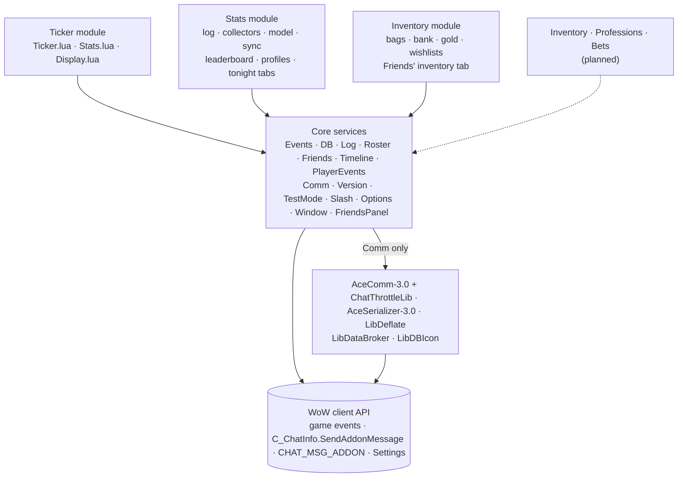
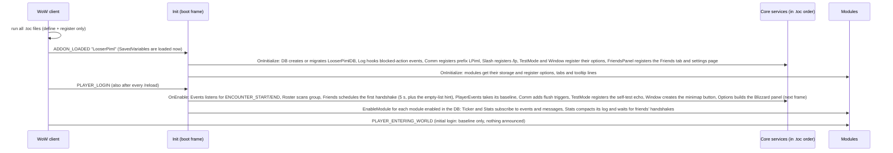
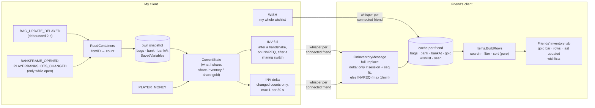
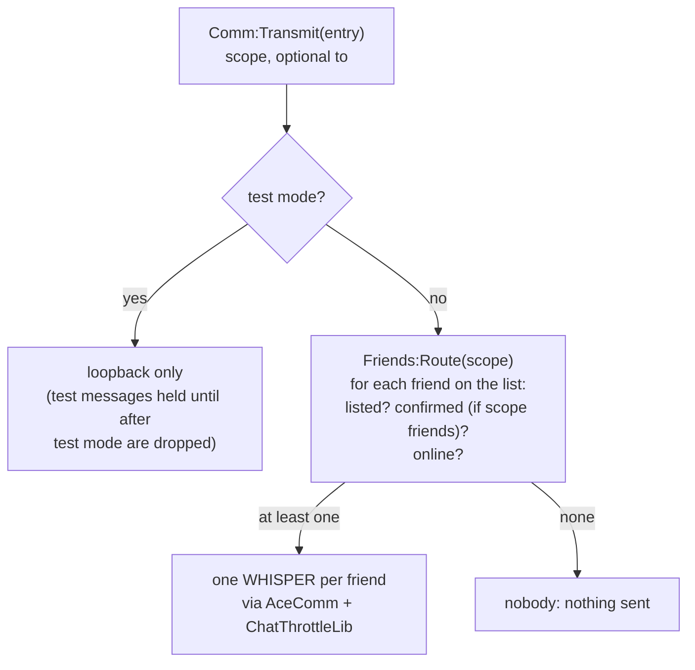
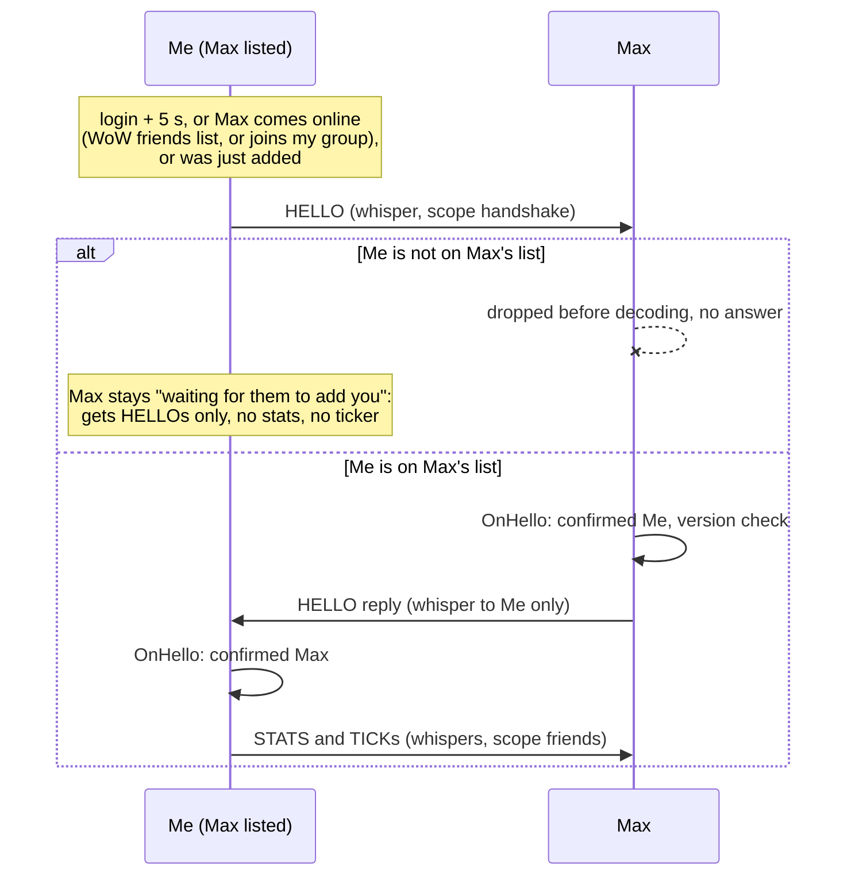
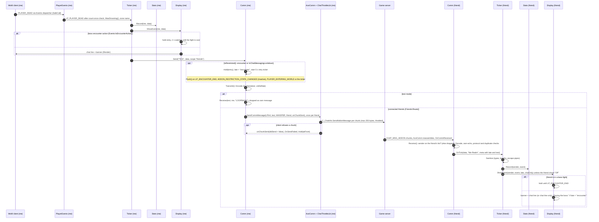
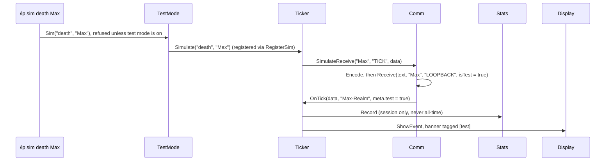

# Architecture

How LooserPiml is put together. Keep this file current when files, load
order, message flow or restriction handling change (see CLAUDE.md).

## The idea in one paragraph

The core unit is the **circle of LooserPiml friends**, not the WoW group:
friends often play separately and only sometimes group up, and everything
works either way. Every client watches only **its own** player. The
**Ticker** announces what happens (death, level up, dungeon): shown locally
right away, then whispered as a hidden addon message to every connected
friend, wherever they are; their clients check it and show it (banner, chat
line only, or not at all, as each friend prefers). The **Stats** module records much more of
the own character's life (gold, loot, quests, duels, ...) in a local log,
condenses it into totals and shares only those totals with friends, which
feeds the **Leaderboard**, **Profiles** and **Tonight** tabs. The
**Inventory** module shares bags, bank and gold on hand, plus everyone's
own **wishlist**, for the Friends' inventory tab. LooserPiml talks **only to players on the
explicit, mutual LooserPiml friends list** (see "Communication: only with
LooserPiml friends"); nobody else receives anything, not even hidden addon
messages. Nobody ever inspects other players, so no secret unit data is
needed. While the game blocks addon messages (boss encounters), outgoing
messages wait in a queue and banners are held. Both come out after the
fight. Friends never need slash commands: the minimap button opens the
window (leaderboard and friends list), and everything else is in
Options › AddOns › LooserPiml.

Modules never call each other. They only use Core: game events via
`ns.Events` (including `LP_*` messages such as `LP_PLAYER_DEAD` from
PlayerEvents), network via `ns.Comm`, storage via `ns.DB`, settings via
`ns.Options`, window tabs and tooltip lines via `ns.Window`. That keeps a
module removable.

## Files

### Addon (loaded by the game)

| File | Job | Look at |
|---|---|---|
| `LooserPiml.toc` | Metadata (Interface 16001, version placeholder, SavedVariables) and the **load order** | — |
| `Core/Init.lua` | Creates the shared namespace `ns`, the core-service and module registries, the lifecycle (ADDON_LOADED → `ns:Initialize`, PLAYER_LOGIN → `ns:Enable`), `ns.SafeCall`, `ns.IsSecret` | `RegisterCore`, `NewModule`, `EnableModule`/`DisableModule`, boot frame |
| `Core/Util.lua` | Pure helpers: localized GlobalStrings format → pattern matching (positional args), own loot message parsing and item quality, money/duration/"ago" formatting, gaming day start, table copy | `MatchFormat`, `ParseOwnLoot`, `FormatMoney`, `FormatAgo`, `GamingDayStart` |
| `Locales/enUS.lua` | Every user-visible string in `ns.L`, incl. the Ticker text variants with `{name}`-style tokens | `L.TICKER` |
| `Core/Events.lua` | The single event frame; dispatches game events and internal `LP_*` messages to registered owners; tracks boss-encounter state | `Register`, `dispatch`, `IsEncounterActive`, `SetSimulatedEncounter` |
| `Core/DB.lua` | `LooserPimlDB`: defaults, `schemaVersion`, ordered migrations, per-module storage | `Migrate`, `GetModuleDB` |
| `Core/Log.lua` | Ring buffer + chat output by level; records ADDON_ACTION_BLOCKED/FORBIDDEN, LUA_WARNING, our Lua errors | `IsVerbose`, `CaptureError`, `InstallErrorHook` |
| `Core/Roster.lua` | Group members as `Name-Realm` with class and connection state (context only: online info, "Add from group", time grouped), fake friends for test mode | `Scan`, `Normalize`, `ColorName` |
| `Core/Timeline.lua` | Own and friends' ticker events of the last 7 days (fed by the Ticker), for the Tonight tab and "looted tonight" | `Add`, `Between`, `Prune` |
| `Core/Friends.lua` | The LooserPiml friends list (SavedVariables), name parsing, WoW friends list candidates, online state, handshake state ("confirmed"), and `Route()`: which connected friends get a message of a given scope (one whisper each). The enforcement point of the communication rule | `Add`, `Remove`, `IsListed`, `OnHandshake`, `UpdateOnline`, `IsConnected`, `Allowed`, `Route` |
| `Core/PlayerEvents.lua` | Detects the own player's death (incl. drowned), level-up and instance enter/leave (with corpse-run rule) and fires `LP_PLAYER_DEAD`, `LP_PLAYER_LEVEL_UP`, `LP_INSTANCE_ENTER/LEAVE` for any module | `PLAYER_DEAD`, `WasDrowning`, `PLAYER_ENTERING_WORLD`, `GetCurrentInstance` |
| `Core/Comm.lua` | Encoding, sending (one WHISPER per recipient from `Friends:Route` at transmit time, hold queue with optional replace key, retries, test-mode messages never go out), receiving (drops senders who aren't listed before decoding, filters, dispatch to handlers), test loopback, self-test ping; fires `LP_COMM_SENT` per real transmission | `Send`, `IsRestricted`, `Hold`, `Flush`, `Transmit`, `Receive` |
| `Core/Version.lua` | HELLO handshake with listed friends only (greetings, replies, per-friend cooldown; an answer means "mutual") and local version warnings | `Greet`, `Reply`, `OnHello`, `Check`, `Compare` |
| `Core/TestMode.lua` | `/lp test` (loopback + fake friends), simulation registry (`/lp sim`), `/lp selftest` (real transport: whisper ping to a connected friend, who echoes it) and the echo for friends' self-tests | `Enable`, `Sim`, `SimEncounter`, `SelfTest`, `OnSelfTestPing` |
| `Core/Slash.lua` | `/lp` dispatcher; modules register subcommands | `Register`, `Dispatch` |
| `Core/Options.lua` | Settings registry (checkboxes, sliders, dropdowns, buttons, canvas pages): modules register options (get/set on their own SavedVariables); after login it builds the Blizzard panel (Options › AddOns › LooserPiml) with proxy settings; confirmation dialogs | `AddSection`, `Add`, `AddCanvas`, `Set`, `BuildPanel`, `Open`, `Confirm` |
| `Core/Window.lua` | Main window shell (theme, title, ESC, saved position, tab registry, footer with version status + Settings button), minimap button (LibDataBroker launcher + LibDBIcon) with tooltip providers, Addon Compartment callbacks, `/lp stats` | `RegisterTab`, `AddTooltipProvider`, `Open`, `Toggle`, `GetVersionStatus` |
| `Core/FriendsPanel.lua` | The friends list UI, built twice: the Friends tab and the settings page Options › AddOns › LooserPiml › Friends (canvas subcategory). Add by name, add from group (real members only), add from the WoW friends list, remove per row | `Create`, `Refresh`, `FillCandidates` |
| `Modules/Ticker/Ticker.lua` | Creates the Ticker module; turns `LP_PLAYER_*`/`LP_INSTANCE_*` messages into announcements, sends them to connected friends, receives theirs (shown as banner, chat line only or not at all: "Ticker messages from friends") | `OnOwnEvent`, `OnPlayerDead`, `Sanitize`, `OnTick`, `GetFriendsDisplay`, `Simulate` |
| `Modules/Ticker/Stats.lua` | Counters per player: session (memory) and all-time (SavedVariables) | `Record`, `Ranking`, `BuildReport` |
| `Modules/Ticker/Display.lua` | Turns an event into text, combines friends entering/leaving the same instance into one banner, banner queue, chat-only entries, encounter hold (boss recap switch), local chat line, banner frame with configurable time/size/position (move/lock) | `Format`, `Collect`, `Show`, `Compose`, `OnEncounterEnd`, `Render`, `SetUnlocked` |
| `Modules/Stats/Stats.lua` | Stats module: per-character event log and daily buckets in SavedVariables, recording, compaction, group time with confirmed friends | `Record`, `Count`, `GetAggregates`, `Tick` |
| `Modules/Stats/Model.lua` | Pure data model: gaming day/week periods, aggregates per event type, rollup + cap, sanitizing received aggregates | `AddEvent`, `Merge`, `Compact`, `Aggregate`, `Sanitize` |
| `Modules/Stats/Collectors.lua` | Game events → `Record()`: death, level-up (played time), quests, instances, boss kills/wipes, zones, flights, hearthstone, jumps (post-hook), food/drink | `EnableCollectors`, `PostHook`, `OnJump` |
| `Modules/Stats/Money.lua` | Every gold change with a source from hints (quest, repair, flight, mail/AH mail) or the open window | `ClassifyMoney`, `OnPlayerMoney` |
| `Modules/Stats/Loot.lua` | Own rare+ loot (quality from the item API or the link), crafted items, gathering (herb/ore/skinning told apart by the cast before the loot window, fishing), chests as a separate counter, skill-ups, parsed from loot/skill messages via the client's own format strings | `ParseLootMessage`, `ItemQuality`, `NoteCast`, `OnLootOpened` |
| `Modules/Stats/PvP.lua` | Duels (own only, opponent runs LooserPiml?), battleground joined/finished/deserted with own scoreboard row after the match, honor snapshots | `ParseDuel`, `OnPvPMatchComplete`, `ReadOwnScore` |
| `Modules/Stats/Sync.lua` | Sends own aggregates to connected friends (when a handshake arrives, after changes; ≤ 1 per 30 s; off with "share my stats"), caches friends' aggregates with last-seen (`friendStats`), staleness of tonight/week, participants for the leaderboard (friends who answered a handshake), sample friends in test mode | `RequestBroadcast`, `OnStatsMessage`, `GetParticipants`, `FillSampleFriends` |
| `Modules/Stats/Leaderboard.lua` | Pure data provider: Hall of Fame awards (Death King, Fish Food, Gold Hoarder by current gold, Speedrunner; earlier achiever wins ties) and ranking rows with bar fractions. "Snapshot" metrics (gold) come from the participant, not the period aggregate, and leave out whoever doesn't share them | `Value`, `Award`, `HallOfFame`, `Ranking`, `Format` |
| `Modules/Stats/LeaderboardTab.lua` | Leaderboard tab (period selector, Hall of Fame cards, metric selector, ranking rows with bars) and the stats lines of the minimap tooltip; frame code only | `Create`, `Refresh`, `FillTooltip` |
| `Modules/Stats/Profiles.lua` | Profile extras sent with STATS (professions, favourite zone, evenings played), the pure profile → sections mapping ("—" for missing data) and the Profiles tab | `GetProfiles`, `Profiles.Sections`, `CleanProfileExtras` |
| `Modules/Stats/Tonight.lua` | Tonight tab (recap card, KPI tiles, timeline) and the one-time "Last evening" popup | `Tonight.Recap`, `Tonight.Totals`, `CheckEveningRecap`, `ShowEveningRecap` |
| `Modules/Inventory/Inventory.lua` | Inventory module: own bags (debounced), bank (while open), gold; full snapshot + delta sync to connected friends; friends' cache; sharing settings | `ScanBags`, `ScanBank`, `SendFull`, `RequestDelta`, `OnInventoryMessage`, `GetHolders` |
| `Modules/Inventory/Items.lua` | Item info with async loading (`Item:ContinueOnItemLoad`) and the pure search/filter/sort provider for the tab | `Info`, `Load`, `BuildRows`, `TotalHeld` |
| `Modules/Inventory/InventoryTab.lua` | The Friends' inventory tab: gold bar, search, filters, item rows with holder chips, "Last updated" column | `Create`, `Refresh`, `UpdatedText` |
| `Modules/Inventory/Wishlist.lua` | Own wishlist (edit), friends' wishlists (read-only), wishlist loot detection (→ `LP_WISHLIST_LOOT` → Ticker), the Wishlists view | `AddWish`, `RemoveWish`, `OnWishMessage`, `GetWishEntries`, `OnChatMsgLoot` |
| `Libs/…` | LibStub, CallbackHandler, AceComm (+ ChatThrottleLib), AceSerializer, LibDeflate, LibDataBroker, LibDBIcon (minimap button). Fetched, not committed | — |

### Development only (not in the release zip)

| File | Job |
|---|---|
| `spec/support/wow_mock.lua` | Simulated game client: its own global environment, clock, timers, frames, events, units, network. Errors on visible chat |
| `spec/support/helpers.lua` | Loads every `.toc` file (libraries included) into a mock client and boots it; builds connected friends who are not grouped (`H.friends`) or a party (`H.group`); checks every send |
| `spec/*_spec.lua` | busted tests per area (core, comm, version, friends, stats, ticker, options, window) |
| `tools/fetch-libs.ps1` | Downloads the pinned libraries into `Libs/` |
| `tools/link-addon.ps1` | Junction `<client>\Interface\AddOns\LooserPiml` → repo |
| `tools/setup-test-env.ps1`, `tools/run-tests.ps1` | Lua 5.1 + busted toolchain, test runner |
| `.pkgmeta`, `.github/workflows/*.yml` | Packager config (libs as externals) and CI: tests on push, release zip on tag `v*` |

## Load order and lifecycle

The game runs the `.toc` files top to bottom, each exactly once, passing
`(addonName, ns)`. That's the `local ADDON_NAME, ns = ...` at the top of
every file, and `ns` is the one table they all share. At load time files only
define functions and register themselves. Game data isn't trusted until
login.

| # | File | Why it sits here |
|---|---|---|
| 1–7 | `Libs\…` | Everything below uses `LibStub(...)`. LibStub first, CallbackHandler before AceComm (AceComm builds on it), LibDataBroker before LibDBIcon |
| 6 | `Core\Init.lua` | Defines `ns:RegisterCore` / `ns:NewModule`, which every later file calls |
| 7 | `Locales\enUS.lua` | Later files capture `local L = ns.L` at load time |
| 8–19 | `Core\Events` → `DB` → `Log` → `Roster` → `Friends` → `PlayerEvents` → `Comm` → `Version` → `TestMode` → `Slash` → `Options` → `Window` → `FriendsPanel` | Registration order = initialization order. `DB` must initialize before `Log` reads the debug flag and before any module asks for storage. `Friends` needs `Roster`; `FriendsPanel` uses `Window`'s widget helpers at load time |
| 16 | `Modules\Ticker\Ticker.lua` | Creates the module with `ns:NewModule("Ticker")` |
| 17–18 | `Stats.lua`, `Display.lua` | Attach to that module (`ns:GetModule("Ticker")`), so they must come after it |
| … | `Modules\Stats\Stats.lua` → `Model` … `LeaderboardTab` → `Profiles` → `Tonight` | The same pattern: the module file first, the files that attach to it after |
| … | `Modules\Inventory\Inventory.lua` → `Items` → `InventoryTab` → `Wishlist` | `Wishlist` adds its view to the tab table created by `InventoryTab` |
| | `Core\Timeline.lua` (after `Friends`) | Core service: the Ticker adds to it, Stats and Inventory read it |

Then the lifecycle:

## Stats: from a game event to the leaderboard

```mermaid
flowchart LR
    subgraph Mine["My client"]
        GE["Game events<br/>PLAYER_MONEY, CHAT_MSG_LOOT,<br/>QUEST_TURNED_IN, ..."]
        PE["Core/PlayerEvents<br/>LP_PLAYER_DEAD, LP_PLAYER_LEVEL_UP,<br/>LP_INSTANCE_ENTER/LEAVE"]
        COL["Collectors, Money,<br/>Loot, PvP"]
        LOG[("Event log<br/>per character<br/>SavedVariables")]
        BUCKET[("Daily buckets<br/>rollups + live counters<br/>jumps, food, group time")]
        AGG["Model.AggregateAll<br/>tonight · week · all"]
        SYNC["Sync<br/>STATS message to confirmed<br/>friends, max 1 per 30 s"]
    end
    subgraph Friend["Friend's client"]
        CACHE[("Stats cache friendStats<br/>SavedVariables,<br/>last seen")]
        PART["GetParticipants<br/>me + listed friends who<br/>answered a handshake<br/>(+ sample friends)"]
        LB["Leaderboard.lua<br/>awards, ranking (pure)"]
        UI["LeaderboardTab<br/>+ minimap tooltip"]
    end
    GE --> COL
    GE --> PE --> COL
    COL -->|"Record()"| LOG
    COL -->|"Count()"| BUCKET
    LOG -->|"Compact: older than 30 days<br/>or beyond 5000 events"| BUCKET
    LOG --> AGG
    BUCKET --> AGG
    AGG --> SYNC -->|"Comm: routed via Friends,<br/>held during bosses,<br/>newest replaces older"| CACHE
    CACHE --> PART --> LB --> UI
```

The same flow runs the other way round too: my own aggregates join
`GetParticipants` directly, and friends' STATS end up in my cache.

1. **Collect**: each collector turns one kind of game event into
   `Stats:Record(type, data)`. Every log entry gets the same context fields
   (time, zone, level, instance, group size). Things that happen constantly
   (jumps, food, group time) are counters in today's bucket instead of log
   entries. The "Collect stats" setting turns all of it off.
2. **Gold sources**: `PLAYER_MONEY` has no reason attached, so `Money.lua`
   infers one. A short-lived hint from what just happened (quest turn-in,
   repair, flight, mail or AH mail) wins. Otherwise the open window decides
   (loot, merchant, mail, trade, AH, trainer, flight map), else "other".
3. **Model**: `Model.lua` is pure Lua. Gaming days start at 06:00 local
   time, so a late session still counts as "tonight"; weeks start Monday
   06:00. `Compact` rolls old events into daily buckets without changing
   totals. `AggregateAll` produces the three periods.
4. **Share**: `Sync.lua` sends only the three aggregates, with the
   sender's day/week keys, to every connected friend (scope "friends",
   grouped or not): when a handshake arrives and after changes (at most
   once per 30 s, never with "Share my stats" off). Only award-relevant timestamps
   are included to keep it to a couple of chunks.
5. **Cache**: receivers sanitize every field and keep the latest
   aggregates per friend with "last seen", so offline friends stay on the
   leaderboard. A friend's "tonight" from an earlier day counts as empty.
6. **Show**: `Leaderboard.lua` computes awards (ties go to whoever got
   there first) and rankings from the participants list. `LeaderboardTab`
   only draws them.

## Friends' inventory: from a bag slot to a friend's screen

1. **Collect** (own character, never equipped items): bags are rescanned
   2 s after the last `BAG_UPDATE_DELAYED`; the bank can only be read
   while its window is open, so it is a snapshot with a time ("bank 3
   days ago"). Containers: backpack, bags 1-4, reagent bag; bank
   `Characterbanktab` plus `CharacterBankTab_1-9` (Forever's
   `Enum.BagIndex`). The account bank is left out (it isn't this
   character's).
2. **Send**: a full snapshot to a friend whose handshake just arrived (or
   who asks with INVREQ), then deltas with absolute counts (0 = gone) at
   most every 30 s. Each message carries the session id and a sequence
   number; a delta is applied only on top of the state it was built from.
3. **Not shared = not sent**: switching off "Share my bags and bank" or
   "Share my gold" sends everyone a new full snapshot without that part,
   and receivers drop what they had. The switches live in
   `LooserPimlDB.share`, because Stats (Gold Hoarder) uses gold too.
4. **Size**: a full snapshot with 300 distinct items is about 0.9 KB on
   the wire (4 chunks); deltas are usually one chunk. With BULK priority
   and ChatThrottleLib this is a few seconds of background traffic per
   friend after login, and then almost nothing.
5. **Wishlists**: each player edits only their own; the whole list goes
   out 5 s after a change and after a handshake, and is stored under the
   sender only. Looting a wished-for item fires `LP_WISHLIST_LOOT`; the
   Ticker turns it into a "wishloot" event (banner "Pew looted Medium
   Leather ×3 · On Justice Beaver's wishlist · 7 still needed").
6. **Show**: uncached item names load asynchronously
   (`Item:ContinueOnItemLoad` → `LP_ITEM_LOADED` → the window redraws).
   There is no button to message a friend: LooserPiml never sends
   whispers or chat on the player's behalf.

## Tonight, Profiles and the timeline

- **Timeline** (`Core/Timeline`): the Ticker adds every own event and every
  friend's ticker event (not simulated ones) with its display text; kept
  7 days in SavedVariables. The Tonight tab shows the entries since 06:00,
  newest at the bottom; the wishlist view counts "looted tonight" from it.
- **Tonight tab**: recap card (awards with data), KPI tiles summed over me
  and my friends' "tonight" aggregates, timeline.
- **Evening recap**: `Stats.previousActiveDay` is read before anything is
  recorded at login; if it is before today and wasn't shown yet, a local
  popup shows that day's awards and totals (my aggregate of that day plus
  friends' cached "tonight" of that day). Once per evening.
- **Profiles tab**: all-time aggregates plus extras from the STATS message
  (`prof`, `fav`, `eve`); `Profiles.Sections` maps them to labels and
  values and shows "—" where nothing is known.

## Settings and window

`Core/Options` is a registry. Ticker, Stats, TestMode and Window each add
their own options with get/set functions on their own SavedVariables. After
login the registry builds one Blizzard Settings category from them, using
proxy settings, so the panel always shows live values (a `/lp sound off`
is reflected immediately). `Core/Window` is a shell with a tab registry.
Modules add tabs and minimap-tooltip lines, so later stages (Profiles, PvP,
Tonight) plug in without touching the window code.

Options can be checkboxes, sliders, dropdowns (e.g. "Ticker messages from
friends": Banner / Chat line only / Off) or buttons. Pages whose content
changes at runtime (the friends list, with a remove button per row) can't
be built from Blizzard's vertical layout. They are
registered with `Options:AddCanvas` and become canvas subcategories
(Options › AddOns › LooserPiml › Friends). `Core/FriendsPanel` builds the
same panel twice: for that settings page and for the window's Friends tab.

## Communication: only with LooserPiml friends

**Hard rule:** LooserPiml communicates only with players on the player's
explicit LooserPiml friends list, and only once they listed them too.
Players without LooserPiml, or who aren't listed, never receive anything,
not even a hidden addon message. There is no discovery of any kind, no
GUILD channel and no Battle.net.

**Transport:** every message is one **WHISPER addon message per connected
friend** (listed + answered the handshake + online). PARTY, RAID and
INSTANCE_CHAT are never used, also not when the whole group is friends.
That keeps the rule simple (no special cases for mixed groups) and works
the same whether friends are grouped or each playing on their own.

Three pieces enforce it:

1. **Sending** (`Comm:Send` → `Comm:Transmit` → `Friends:Route`). Every
   message has a scope. When the message really goes out (also after it
   was held during a boss), `Route` returns the friends who get it:

   | Scope | Used by | Goes to |
   |---|---|---|
   | `handshake` | HELLO | listed friends who are online |
   | `friends` | TICK, STATS, INV, INVREQ, WISH, SELFTEST(_ECHO) | connected friends: listed, answered the handshake this session, online |

2. **Receiving** (`Comm:Receive`). A message from a sender who isn't on the
   own list is dropped before it is even decoded. That is what makes the
   list mutual: if Max isn't on my list, nothing Max sends ever reaches my
   handlers, and I never answer.
3. **Mutual = answered handshake** (`Version`, `Friends:OnHandshake`). A
   listed friend's HELLO reaches my handlers only if they're on my list,
   and they send one only if I'm on theirs. So a HELLO from them proves the
   friendship is mutual, and they become "confirmed" for this session.
   Going offline forgets it; the next contact starts with a fresh handshake.

The handshake, with Max on my list (grouped or not):

Details worth knowing:

- **Online** means online on the character friends list (`C_FriendList`),
  or a connected member of my group (`UnitIsConnected`). That's why
  friends should also be on each other's WoW friends list: without it,
  LooserPiml can't tell they're online unless you group up. Whispering
  someone offline makes the server print "No player named ...", so
  whispers wait for one of those signals. The one exception: a handshake
  reply may go to a friend who wrote to us in the last 30 s
  (`REPLY_WINDOW`), otherwise the handshake couldn't finish when only one
  side has the other on the friends list.
- **Grouping is context, never a precondition.** The group is one source
  of "online", the "Add from group" buttons, and time spent grouped with a
  friend in the stats. Nothing waits for, or is limited to, a group.
- **Removing a friend** takes effect at once: `Route` reads the list for
  every message, held ones included. Only chunks already handed to
  ChatThrottleLib in the last moment (it paces them over a second or two)
  can't be called back.
- **Test mode** never reaches real players: everything loops back, messages
  created in test mode are dropped if they would be flushed after it ended,
  the self-test's real transport is skipped, and the fake friends can't be
  added to the friends list.
- **Self-test**: `/lp selftest` whispers a multi-chunk payload to one
  connected friend; that friend's client whispers it back
  (`TestMode:OnSelfTestPing`, at most once per 10 s per friend). Whispers
  to yourself are rejected by the server, so there is no solo transport
  test.
- **Traffic**: one whisper per connected friend per message, so five
  friends online means five copies, still throttled by ChatThrottleLib.
  Stats go out at most every 30 s; ticker events only on real events.

## One event end to end: my death on my friend's screen

Two clients, "Me" and my friend. Numbered steps are explained below the
diagram.

1. The game fires `PLAYER_DEAD`. `Core/Events.lua` is the only frame
   registered for it and calls `PlayerEvents:PLAYER_DEAD` through
   `ns.SafeCall`, so one buggy handler can't break the others.
   PlayerEvents fires the internal `LP_PLAYER_DEAD` message, which the
   Ticker (and the Stats module) receive.
2. `PlayerEvents.dead` makes sure one death is counted once until
   `PLAYER_ALIVE`/`PLAYER_UNGHOST`. `WasDrowning()` looks at the breath
   mirror timer (see Restrictions).
3. Stats first, so the banner can say "Death #3".
4. **Local first**: my own banner never waits for the network. That works
   solo and during restrictions.
5. **Encounter hold, receiving side of the UI**: during a boss fight
   `Display` holds banners (my own too) and shows them afterwards. A 2 s
   watcher releases them even if no end event arrives.
6. `Comm:Send` is the single door to the network. Every module uses it,
   always with a scope (see "Communication: only with LooserPiml friends").
7. **Encounter queue, sending side**: if `Comm:IsRestricted()` says no, the
   message goes into `Comm.queue` with `late = "encounter"` (or
   `"lockdown"`). Several triggers call `Flush()`, which re-checks and then
   uses the same `Transmit()`. `Transmit()` asks `Friends:Route` only then,
   so a friend removed or gone offline in the meantime is handled.
8. Encoding: AceSerializer (table → string), LibDeflate compress, then
   re-encode so the bytes are allowed on the addon channel.
9. **Test-mode loopback**: in test mode `Transmit()` never touches the
   network. It feeds the encoded text straight into our own `Receive()`,
   which drops it as "own message". The point is to prove that
   encode/decode works without anything leaving the client. Simulated
   *friends* use a separate entry point (next section).
10. AceComm splits into ≤255-byte chunks, ChatThrottleLib paces them, and
    the client API sends them.
11. **Refusals**: if the client still refuses (e.g. lockdown started
    between check and send), AceComm reports `didSend = false` per chunk.
    `Comm` puts the whole message back at the front of the queue, at most
    5 attempts.
12. Whispers are not echoed to the sender; `Receive()` still ignores its
    own name (test-mode loopback).
13. On the friend's side AceComm reassembles chunks and calls
    `Comm:OnCommReceived`.
14. `Receive()` first drops the message if the sender isn't on the
    friend's LooserPiml list. Then it decodes and filters: own echo, other
    protocol version (except HELLO), and duplicates keyed by sender +
    session + id. Then it dispatches to every handler registered for
    `"TICK"`.
15. `Ticker:OnTick` → `Sanitize` copies only known fields with correct types
    and escapes `|`.
16. Stats count it; real events also go into the all-time stats.
17. Display: shown as the friend chose ("Ticker messages from friends":
    banner, chat line only, off), held if they are fighting. The sender's
    `late` flag becomes the "During the boss:" prefix. Enter/leave events
    wait 2 s so friends entering the same instance together get one banner
    ("Max and Lootius entered The Deadmines.").

### Test mode: `/lp sim death Max`

The fake friend's message runs the same decode → filter → handler →
stats → display path as a real one. Only the network is skipped. Without a
name (`/lp sim death`) it calls `OnOwnEvent` instead, the same path as a
real death of yours. `/lp sim boss` toggles `Events:SetSimulatedEncounter`,
which fires the same `LP_ENCOUNTER_START/END` messages as a real boss, so
both hold mechanisms run.

## Where the Forever/Midnight restrictions are handled

WoW: Forever uses Retail's (Midnight) addon rules. What that means here:

| Restriction | Where | How we deal with it |
|---|---|---|
| Addon messages blocked during boss encounters (and other chat-lockdown states: M+, PvP, possibly restricted maps) | `Comm:IsRestricted`, `Comm:Hold`/`Flush`, encounter state in `Events.lua` | Don't even try while restricted: queue, flush afterwards, mark as late. Signals: our ENCOUNTER_START/END tracking, `C_InstanceEncounter.IsEncounterInProgress()`, `C_ChatInfo.InChatMessagingLockdown()`, `ADDON_RESTRICTION_STATE_CHANGED` |
| The client may still refuse a send (result `AddOnMessageLockdown`) | `onChunkSent` → `Comm:OnSendFailed` | Requeue at the front, retry every 5 s, give up after 5 attempts. ChatThrottleLib alone would drop it |
| Secret values (API results we may not inspect) | `ns.IsSecret` (Init.lua), used in Roster, Events, Comm, Ticker | Check before any compare, arithmetic or concatenation; drop the value and degrade. Secret encounter state counts as "restricted"; secret breath timer means no "drowned" variant; secret unit identity means the member is skipped |
| `COMBAT_LOG_EVENT_UNFILTERED` can't be registered | `Ticker.lua` drowning section | No cause-of-death from the combat log. Drowning is derived from the breath mirror timer only |
| Events that don't exist on this client | `Events:Register` (`C_EventUtils.IsEventValid`) | Skipped with a debug line instead of a Lua error |
| Protected functions / blocked actions | `Log.lua` | We call none. ADDON_ACTION_BLOCKED/FORBIDDEN are recorded and shown in debug/test mode so a hit is obvious |
| Throttling (per prefix, server side) | ChatThrottleLib (via AceComm), `Version.HELLO_COOLDOWN`, queue cap | Messages only on real events; compressed to few chunks; at most one HELLO per friend per 10 s |
| No visible chat, no automation | By design; enforced by `spec/support/wow_mock.lua` | Output is `DEFAULT_CHAT_FRAME:AddMessage` + our own frames only. `RequestTimePlayed` is never called (it prints to chat); played time comes from our own session timer |
| Protected functions we want to observe (`JumpOrAscendStart`) | `Stats:PostHook` (Collectors.lua) | `hooksecurefunc` post-hooks only: they run after Blizzard's code and can't change or block it. Never called, never replaced |
| Chat payloads secret during chat lockdown (`CHAT_MSG_SKILL`, `CHAT_MSG_SYSTEM`) | `Util.MatchFormat` | Secret text is never matched; the skill-up or duel is simply not recorded |
| Spell casts secret while restricted (`UNIT_SPELLCAST_SUCCEEDED`) | `Stats:OnSpellcastSucceeded`, `Stats:NoteCast` | Secret spell ID: hearthstone/food/drink not counted, and the next loot window is neither gathering nor a chest |
| PvP scoreboard secret during an active match (`C_PvP.GetScoreInfo`) | `PvP.lua` | Read only after `PVP_MATCH_COMPLETE`; every value checked, secret ones dropped |
| System messages are localized | `Util.MatchFormat` with the client's GlobalStrings | Loot, skill and duel messages are parsed with the client's own format strings, never hard-coded English |
| Addon whispers to yourself are rejected | `Comm:SendSelfTest`, `TestMode:OnSelfTestPing` | The real-transport test is a ping to a connected friend, who echoes it |
| Whispers to offline players produce a "No player named ..." system message | `Friends:IsOnline`, `Roster` (`UnitIsConnected`) | Whispers only to friends online on the friends list or connected group members (plus handshake replies within 30 s) |

Everything here that couldn't be verified offline is marked
`TODO(verify in-game)` in the code and listed in TESTING.md.

## How the tests see the addon

`spec/support/helpers.lua` reads `LooserPiml.toc`, expands the library XML
files and loads every file with `setfenv` into a fresh environment built by
`wow_mock.lua`. So each simulated client has its own globals, LibStub and
ChatThrottleLib, and two clients can run side by side in one Lua process.
Clients on a shared mock network exchange real AceComm chunks. Like the
real server, the mock delivers a whisper only to an online player.
`H.friends` builds connected friends who are not grouped (the normal
case), `H.group` friends in a party. Every test checks every single
`SendAddonMessage` call (`H.checkRecipients`): it must be a WHISPER to a
listed friend, so no code path can quietly use a group channel or reach a
player who isn't listed.
`ticker_spec.lua` → "two clients end to end" walks the whole diagram above;
`friends_spec.lua` covers the communication rule.
