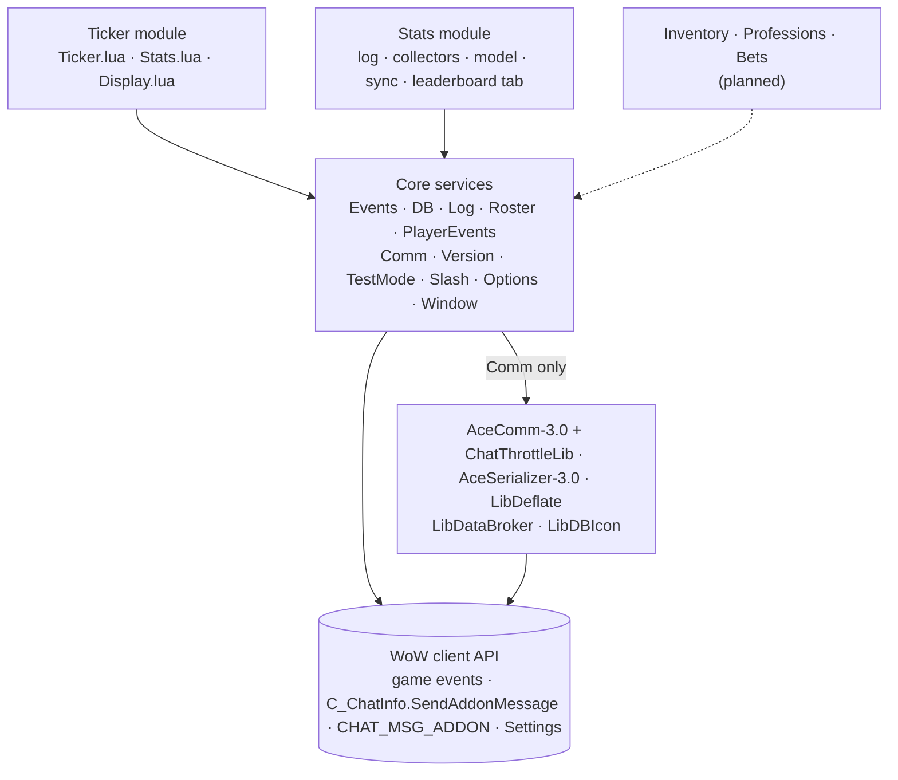
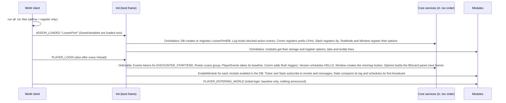
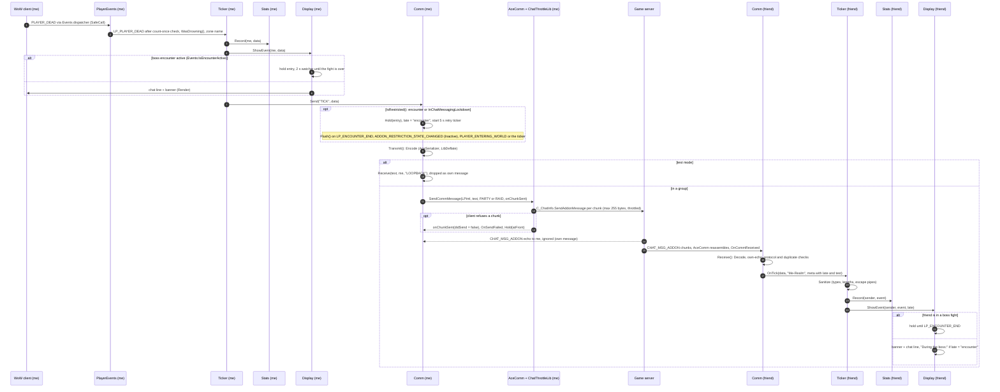
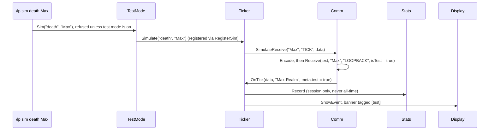

# Architecture

How LooserPiml is put together. Keep this file current when files, load
order, message flow or restriction handling change (see CLAUDE.md).

## The idea in one paragraph

Every client watches only **its own** player. The **Ticker** announces
what happens (death, level up, dungeon): shown locally right away, then
broadcast as a hidden addon message; friends' clients check it and show it.
The **Stats** module records much more of the own character's life (gold,
loot, quests, duels, ...) in a local log, condenses it into totals and
shares only those totals with friends, which feeds the **Leaderboard**
window. Nobody ever inspects other players, so no secret unit data is
needed. While the game blocks addon messages (boss encounters), outgoing
messages wait in a queue and banners are held. Both come out after the
fight. Friends never need slash commands: the minimap button opens the
window, and everything else is in Options › AddOns › LooserPiml.

Modules never call each other. They only use Core: game events via
`ns.Events` (including `LP_*` messages such as `LP_PLAYER_DEAD` from
PlayerEvents), network via `ns.Comm`, storage via `ns.DB`, settings via
`ns.Options`, window tabs and tooltip lines via `ns.Window`. That keeps a
module removable.

## Files

### Addon (loaded by the game)

| File | Job | Look at |
|---|---|---|
| `LooserPiml.toc` | Metadata (Interface 16001, version placeholder, SavedVariables) and the **load order** | — |
| `Core/Init.lua` | Creates the shared namespace `ns`, the core-service and module registries, the lifecycle (ADDON_LOADED → `ns:Initialize`, PLAYER_LOGIN → `ns:Enable`), `ns.SafeCall`, `ns.IsSecret` | `RegisterCore`, `NewModule`, `EnableModule`/`DisableModule`, boot frame |
| `Core/Util.lua` | Pure helpers: localized GlobalStrings format → pattern matching (positional args), money/duration formatting, table copy | `MatchFormat`, `FormatMoney` |
| `Locales/enUS.lua` | Every user-visible string in `ns.L`, incl. the Ticker text variants with `{name}`-style tokens | `L.TICKER` |
| `Core/Events.lua` | The single event frame; dispatches game events and internal `LP_*` messages to registered owners; tracks boss-encounter state | `Register`, `dispatch`, `IsEncounterActive`, `SetSimulatedEncounter` |
| `Core/DB.lua` | `LooserPimlDB`: defaults, `schemaVersion`, ordered migrations, per-module storage | `Migrate`, `GetModuleDB` |
| `Core/Log.lua` | Ring buffer + chat output by level; records ADDON_ACTION_BLOCKED/FORBIDDEN, LUA_WARNING, our Lua errors | `IsVerbose`, `CaptureError`, `InstallErrorHook` |
| `Core/Roster.lua` | Group members as `Name-Realm`, class colors, which addon channel reaches the group, fake members for test mode | `Scan`, `Normalize`, `GetChannel`, `ColorName` |
| `Core/PlayerEvents.lua` | Detects the own player's death (incl. drowned), level-up and instance enter/leave (with corpse-run rule) and fires `LP_PLAYER_DEAD`, `LP_PLAYER_LEVEL_UP`, `LP_INSTANCE_ENTER/LEAVE` for any module | `PLAYER_DEAD`, `WasDrowning`, `PLAYER_ENTERING_WORLD`, `GetCurrentInstance` |
| `Core/Comm.lua` | Encoding, sending (hold queue with optional replace key, retries), receiving (filters, dispatch to handlers), test loopback, self-test transport; fires `LP_COMM_SENT` per real transmission | `Send`, `IsRestricted`, `Hold`, `Flush`, `Transmit`, `Receive` |
| `Core/Version.lua` | HELLO handshake and local version warnings | `SendHello`, `OnHello`, `Check`, `Compare` |
| `Core/TestMode.lua` | `/lp test` (loopback + fake group), simulation registry (`/lp sim`), `/lp selftest` | `Enable`, `Sim`, `SimEncounter`, `SelfTest` |
| `Core/Slash.lua` | `/lp` dispatcher; modules register subcommands | `Register`, `Dispatch` |
| `Core/Options.lua` | Settings registry: modules register options (get/set on their own SavedVariables); after login it builds the Blizzard panel (Options › AddOns › LooserPiml) with proxy settings; confirmation dialogs | `AddSection`, `Add`, `Set`, `BuildPanel`, `Open`, `Confirm` |
| `Core/Window.lua` | Main window shell (theme, title, ESC, saved position, tab registry, footer with version status + Settings button), minimap button (LibDataBroker launcher + LibDBIcon) with tooltip providers, Addon Compartment callbacks, `/lp stats` | `RegisterTab`, `AddTooltipProvider`, `Open`, `Toggle`, `GetVersionStatus` |
| `Modules/Ticker/Ticker.lua` | Creates the Ticker module; turns `LP_PLAYER_*`/`LP_INSTANCE_*` messages into announcements, broadcasts them, receives others' | `OnOwnEvent`, `OnPlayerDead`, `Sanitize`, `OnTick`, `Simulate` |
| `Modules/Ticker/Stats.lua` | Counters per player: session (memory) and all-time (SavedVariables) | `Record`, `Ranking`, `BuildReport` |
| `Modules/Ticker/Display.lua` | Turns an event into text, banner queue, encounter hold (boss recap switch), local chat line, banner frame with configurable time/size/position (move/lock) | `Format`, `Compose`, `ShowEvent`, `OnEncounterEnd`, `Render`, `SetUnlocked` |
| `Modules/Stats/Stats.lua` | Stats module: per-character event log and daily buckets in SavedVariables, recording, compaction, friends cache | `Record`, `Count`, `GetAggregates` |
| `Modules/Stats/Model.lua` | Pure data model: gaming day/week periods, aggregates per event type, rollup + cap, sanitizing received aggregates | `AddEvent`, `Merge`, `Compact`, `Aggregate`, `Sanitize` |
| `Modules/Stats/Collectors.lua` | Game events → `Record()`: death, level-up (played time), quests, instances, boss kills/wipes, zones, flights, hearthstone, jumps (post-hook), food/drink | `EnableCollectors`, `PostHook`, `OnJump` |
| `Modules/Stats/Money.lua` | Every gold change with a source from hints (quest, repair, flight, mail/AH mail) or the open window | `ClassifyMoney`, `OnPlayerMoney` |
| `Modules/Stats/Loot.lua` | Own rare+ loot (quality from the item API or the link), crafted items, gathered nodes/fishing, skill-ups, parsed from loot/skill messages via the client's own format strings | `ParseLootMessage`, `ItemQuality`, `OnLootOpened` |
| `Modules/Stats/PvP.lua` | Duels (own only, opponent runs LooserPiml?), battleground joined/finished/deserted with own scoreboard row after the match, honor snapshots | `ParseDuel`, `OnPvPMatchComplete`, `ReadOwnScore` |
| `Modules/Stats/Sync.lua` | Broadcasts own aggregates (login, group join, after changes; ≤ 1 per 30 s; off with "share my stats"), caches friends' aggregates with last-seen, staleness of tonight/week, participants for the leaderboard, sample friends in test mode | `RequestBroadcast`, `OnStatsMessage`, `GetParticipants`, `FillSampleFriends` |
| `Modules/Stats/Leaderboard.lua` | Pure data provider: Hall of Fame awards (Death King, Fish Food, Gold Hoarder, Speedrunner; earlier achiever wins ties) and ranking rows with bar fractions | `Award`, `HallOfFame`, `Ranking`, `Format` |
| `Modules/Stats/LeaderboardTab.lua` | Leaderboard tab (period selector, Hall of Fame cards, metric selector, ranking rows with bars) and the stats lines of the minimap tooltip; frame code only | `Create`, `Refresh`, `FillTooltip` |
| `Libs/…` | LibStub, CallbackHandler, AceComm (+ ChatThrottleLib), AceSerializer, LibDeflate, LibDataBroker, LibDBIcon (minimap button). Fetched, not committed | — |

### Development only (not in the release zip)

| File | Job |
|---|---|
| `spec/support/wow_mock.lua` | Simulated game client: its own global environment, clock, timers, frames, events, units, network. Errors on visible chat |
| `spec/support/helpers.lua` | Loads every `.toc` file (libraries included) into a mock client and boots it; builds multi-client groups |
| `spec/*_spec.lua` | busted tests per area (core, comm, version, stats, ticker) |
| `tools/fetch-libs.ps1` | Downloads the pinned libraries into `Libs/` |
| `tools/link-addon.ps1` | Junction `<client>\Interface\AddOns\LooserPiml` → repo |
| `tools/setup-test-env.ps1`, `tools/run-tests.ps1` | Lua 5.1 + busted toolchain, test runner |
| `.pkgmeta`, `.github/workflows/*.yml` | Packager config (libs as externals) and CI: tests on push, release zip on tag `v*` |

## Load order and lifecycle

The game runs the `.toc` files top to bottom, each exactly once, passing
`(addonName, ns)`. That's the `local ADDON_NAME, ns = ...` at the top of
every file, and `ns` is the one table they all share. At load time files only
define functions and register themselves. Game data isn't trusted until
login.

| # | File | Why it sits here |
|---|---|---|
| 1–7 | `Libs\…` | Everything below uses `LibStub(...)`. LibStub first, CallbackHandler before AceComm (AceComm builds on it), LibDataBroker before LibDBIcon |
| 6 | `Core\Init.lua` | Defines `ns:RegisterCore` / `ns:NewModule`, which every later file calls |
| 7 | `Locales\enUS.lua` | Later files capture `local L = ns.L` at load time |
| 8–17 | `Core\Events` → `DB` → `Log` → `Roster` → `PlayerEvents` → `Comm` → `Version` → `TestMode` → `Slash` → `Options` → `Window` | Registration order = initialization order. `DB` must initialize before `Log` reads the debug flag and before any module asks for storage |
| 16 | `Modules\Ticker\Ticker.lua` | Creates the module with `ns:NewModule("Ticker")` |
| 17–18 | `Stats.lua`, `Display.lua` | Attach to that module (`ns:GetModule("Ticker")`), so they must come after it |

Then the lifecycle:

## Stats: from a game event to the leaderboard

```mermaid
flowchart LR
    subgraph Mine["My client"]
        GE["Game events<br/>PLAYER_MONEY, CHAT_MSG_LOOT,<br/>QUEST_TURNED_IN, ..."]
        PE["Core/PlayerEvents<br/>LP_PLAYER_DEAD, LP_PLAYER_LEVEL_UP,<br/>LP_INSTANCE_ENTER/LEAVE"]
        COL["Collectors, Money,<br/>Loot, PvP"]
        LOG[("Event log<br/>per character<br/>SavedVariables")]
        BUCKET[("Daily buckets<br/>rollups + live counters<br/>jumps, food, group time")]
        AGG["Model.AggregateAll<br/>tonight · week · all"]
        SYNC["Sync<br/>STATS message,<br/>max 1 per 30 s"]
    end
    subgraph Friend["Friend's client"]
        CACHE[("Friends cache<br/>SavedVariables,<br/>last seen")]
        PART["GetParticipants<br/>me + friends<br/>(+ sample friends)"]
        LB["Leaderboard.lua<br/>awards, ranking (pure)"]
        UI["LeaderboardTab<br/>+ minimap tooltip"]
    end
    GE --> COL
    GE --> PE --> COL
    COL -->|"Record()"| LOG
    COL -->|"Count()"| BUCKET
    LOG -->|"Compact: older than 30 days<br/>or beyond 5000 events"| BUCKET
    LOG --> AGG
    BUCKET --> AGG
    AGG --> SYNC -->|"Comm: held during bosses,<br/>newest replaces older"| CACHE
    CACHE --> PART --> LB --> UI
```

The same flow runs the other way round too: my own aggregates join
`GetParticipants` directly, and friends' STATS end up in my cache.

1. **Collect**: each collector turns one kind of game event into
   `Stats:Record(type, data)`. Every log entry gets the same context fields
   (time, zone, level, instance, group size). Things that happen constantly
   (jumps, food, group time) are counters in today's bucket instead of log
   entries. The "Collect stats" setting turns all of it off.
2. **Gold sources**: `PLAYER_MONEY` has no reason attached, so `Money.lua`
   infers one. A short-lived hint from what just happened (quest turn-in,
   repair, flight, mail or AH mail) wins. Otherwise the open window decides
   (loot, merchant, mail, trade, AH, trainer, flight map), else "other".
3. **Model**: `Model.lua` is pure Lua. Gaming days start at 06:00 local
   time, so a late session still counts as "tonight"; weeks start Monday
   06:00. `Compact` rolls old events into daily buckets without changing
   totals. `AggregateAll` produces the three periods.
4. **Share**: `Sync.lua` sends only the three aggregates, with the
   sender's day/week keys, on login, group join and after changes (at most
   once per 30 s, never with "Share my stats" off). Only award-relevant
   timestamps are included to keep it to a couple of chunks.
5. **Cache**: receivers sanitize every field and keep the latest
   aggregates per friend with "last seen", so offline friends stay on the
   leaderboard. A friend's "tonight" from an earlier day counts as empty.
6. **Show**: `Leaderboard.lua` computes awards (ties go to whoever got
   there first) and rankings from the participants list. `LeaderboardTab`
   only draws them.

## Settings and window

`Core/Options` is a registry. Ticker, Stats, TestMode and Window each add
their own options with get/set functions on their own SavedVariables. After
login the registry builds one Blizzard Settings category from them, using
proxy settings, so the panel always shows live values (a `/lp sound off`
is reflected immediately). `Core/Window` is a shell with a tab registry.
Modules add tabs and minimap-tooltip lines, so later stages (Profiles, PvP,
Tonight) plug in without touching the window code.

## One event end to end: my death on my friend's screen

Two clients, "Me" and my friend. Numbered steps are explained below the
diagram.

1. The game fires `PLAYER_DEAD`. `Core/Events.lua` is the only frame
   registered for it and calls `PlayerEvents:PLAYER_DEAD` through
   `ns.SafeCall`, so one buggy handler can't break the others.
   PlayerEvents fires the internal `LP_PLAYER_DEAD` message, which the
   Ticker (and the Stats module) receive.
2. `PlayerEvents.dead` makes sure one death is counted once until
   `PLAYER_ALIVE`/`PLAYER_UNGHOST`. `WasDrowning()` looks at the breath
   mirror timer (see Restrictions).
3. Stats first, so the banner can say "Death #3".
4. **Local first**: my own banner never waits for the network. That works
   solo and during restrictions.
5. **Encounter hold, receiving side of the UI**: during a boss fight
   `Display` holds banners (my own too) and shows them afterwards. A 2 s
   watcher releases them even if no end event arrives.
6. `Comm:Send` is the single door to the network. Every module uses it.
7. **Encounter queue, sending side**: if `Comm:IsRestricted()` says no, the
   message goes into `Comm.queue` with `late = "encounter"` (or
   `"lockdown"`). Several triggers call `Flush()`, which re-checks and then
   uses the same `Transmit()`. `Transmit()` picks the channel only then, so
   a group that changed in the meantime is handled.
8. Encoding: AceSerializer (table → string), LibDeflate compress, then
   re-encode so the bytes are allowed on the addon channel.
9. **Test-mode loopback**: in test mode `Transmit()` never touches the
   network. It feeds the encoded text straight into our own `Receive()`,
   which drops it as "own message". The point is to prove that
   encode/decode works without anything leaving the client. Simulated
   *friends* use a separate entry point (next section).
10. AceComm splits into ≤255-byte chunks, ChatThrottleLib paces them, and
    the client API sends them.
11. **Refusals**: if the client still refuses (e.g. lockdown started
    between check and send), AceComm reports `didSend = false` per chunk.
    `Comm` puts the whole message back at the front of the queue, at most
    5 attempts.
12. The server echoes group messages to the sender. `Receive()` ignores
    its own name.
13. On the friend's side AceComm reassembles chunks and calls
    `Comm:OnCommReceived`.
14. `Receive()` decodes, then filters: own echo, other protocol version
    (except HELLO), and duplicates keyed by sender + session + id. Then it
    dispatches to every handler registered for `"TICK"`.
15. `Ticker:OnTick` → `Sanitize` copies only known fields with correct types
    and escapes `|`.
16. Stats count it; real events also go into the all-time stats.
17. Display: held if the friend is fighting, otherwise shown. The sender's
    `late` flag becomes the "During the boss:" prefix.

### Test mode: `/lp sim death Max`

The fake friend's message runs the same decode → filter → handler →
stats → display path as a real one. Only the network is skipped. Without a
name (`/lp sim death`) it calls `OnOwnEvent` instead, the same path as a
real death of yours. `/lp sim boss` toggles `Events:SetSimulatedEncounter`,
which fires the same `LP_ENCOUNTER_START/END` messages as a real boss, so
both hold mechanisms run.

## Where the Forever/Midnight restrictions are handled

WoW: Forever uses Retail's (Midnight) addon rules. What that means here:

| Restriction | Where | How we deal with it |
|---|---|---|
| Addon messages blocked during boss encounters (and other chat-lockdown states: M+, PvP, possibly restricted maps) | `Comm:IsRestricted`, `Comm:Hold`/`Flush`, encounter state in `Events.lua` | Don't even try while restricted: queue, flush afterwards, mark as late. Signals: our ENCOUNTER_START/END tracking, `C_InstanceEncounter.IsEncounterInProgress()`, `C_ChatInfo.InChatMessagingLockdown()`, `ADDON_RESTRICTION_STATE_CHANGED` |
| The client may still refuse a send (result `AddOnMessageLockdown`) | `onChunkSent` → `Comm:OnSendFailed` | Requeue at the front, retry every 5 s, give up after 5 attempts. ChatThrottleLib alone would drop it |
| Secret values (API results we may not inspect) | `ns.IsSecret` (Init.lua), used in Roster, Events, Comm, Ticker | Check before any compare, arithmetic or concatenation; drop the value and degrade. Secret encounter state counts as "restricted"; secret breath timer means no "drowned" variant; secret unit identity means the member is skipped |
| `COMBAT_LOG_EVENT_UNFILTERED` can't be registered | `Ticker.lua` drowning section | No cause-of-death from the combat log. Drowning is derived from the breath mirror timer only |
| Events that don't exist on this client | `Events:Register` (`C_EventUtils.IsEventValid`) | Skipped with a debug line instead of a Lua error |
| Protected functions / blocked actions | `Log.lua` | We call none. ADDON_ACTION_BLOCKED/FORBIDDEN are recorded and shown in debug/test mode so a hit is obvious |
| Throttling (per prefix, server side) | ChatThrottleLib (via AceComm), `Version.HELLO_COOLDOWN`, queue cap | Messages only on real events; compressed to few chunks; HELLO bursts coalesced |
| No visible chat, no automation | By design; enforced by `spec/support/wow_mock.lua` | Output is `DEFAULT_CHAT_FRAME:AddMessage` + our own frames only. `RequestTimePlayed` is never called (it prints to chat); played time comes from our own session timer |
| Protected functions we want to observe (`JumpOrAscendStart`) | `Stats:PostHook` (Collectors.lua) | `hooksecurefunc` post-hooks only: they run after Blizzard's code and can't change or block it. Never called, never replaced |
| Chat payloads secret during chat lockdown (`CHAT_MSG_SKILL`, `CHAT_MSG_SYSTEM`) | `Util.MatchFormat` | Secret text is never matched; the skill-up or duel is simply not recorded |
| Spell casts secret while restricted (`UNIT_SPELLCAST_SUCCEEDED`) | `Stats:OnSpellcastSucceeded` | Secret spell ID: hearthstone/food/drink not counted |
| PvP scoreboard secret during an active match (`C_PvP.GetScoreInfo`) | `PvP.lua` | Read only after `PVP_MATCH_COMPLETE`; every value checked, secret ones dropped |
| System messages are localized | `Util.MatchFormat` with the client's GlobalStrings | Loot, skill and duel messages are parsed with the client's own format strings, never hard-coded English |
| Addon whispers to yourself are rejected | `Comm:SendSelfTest`, `Sync.lua` | Real transport tests and stats sync use group channels only |

Everything here that couldn't be verified offline is marked
`TODO(verify in-game)` in the code and listed in TESTING.md.

## How the tests see the addon

`spec/support/helpers.lua` reads `LooserPiml.toc`, expands the library XML
files and loads every file with `setfenv` into a fresh environment built by
`wow_mock.lua`. So each simulated client has its own globals, LibStub and
ChatThrottleLib, and two clients can run side by side in one Lua process.
Clients on a shared mock network exchange real AceComm chunks.
`ticker_spec.lua` → "two clients end to end" walks the whole diagram above.
